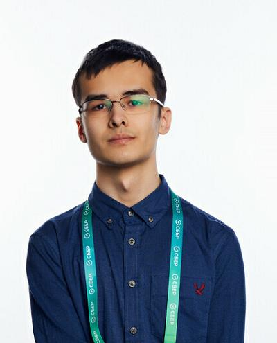

# Дмитрий Авдеев

**ML / DL Researcher**  
[Email](mailto:deavdeev@edu.hse.ru) · [GitHub](https://github.com/AD179-sys) · [Codeforces](https://codeforces.com/profile/127.0.0.1)

Ищу исследовательскую позицию или стажировку в ML/DL. Есть опыт работы с видеогенерацией в команде Kandinsky World Model, реализации нейросетевых методов для аудио и изображений, а также исследований в многоагентном планировании путей.

 

## Опыт

**Сбер — стажировка в команде Kandinsky World Model**

- Работал с Kandinsky, Flow Matching, Self-Refine, V-JEPA и бенчмарками физической достоверности видео Physics-IQ и Physics-IQ Verified.
- Соавтор работы [«Kandinsky WM 1.0: генеративные модели для Physical AI»](https://habr.com/ru/companies/sberbank/articles/1054966/) в блоге Сбера на Habr.

## Исследования

**Stepan Dergachev, Dmitry Avdeev. [Relaxing Constraints in Anonymous Multi Agent Path Finding for Large Agents](https://arxiv.org/abs/2603.24442).** Препринт arXiv, 2026.

Я исследовал задачу бесконфликтного планирования движения взаимозаменяемых агентов (Anonymous Multi-Agent Path Finding, AMAPF). Задача возникает, например, при автоматизации складов. В работе предложена модификация алгоритма Solovey et al. [4], сохраняющая все теоретические свойства и позволяющая решать задачу в более плотной среде с дефицитом места.

## Проекты

- **[SoundStream](https://github.com/AD179-sys/SoundStream)** — учебная реализация нейросетевого сжатия аудио по статье [1]. Реализованы encoder/decoder, residual vector quantization и обучение с дискриминаторами. В [демо](https://github.com/AD179-sys/SoundStream/blob/main/Demo_and_inference.ipynb) есть восстановленное аудио и оценка STOI/NISQA.
- **[ADMM-analys](https://github.com/AD179-sys/ADMM-analys)** — учебный проект по восстановлению изображений безлинзовой камеры: ADMM-100, обучаемый LeADMM-20 и варианты с нейросетевой предобработкой и постобработкой. Методы описаны в работах [2, 3]. Подготовлены обучение, инференс и [демо сравнения](https://github.com/AD179-sys/ADMM-analys/blob/main/Demo_and_inference.ipynb) с PSNR, SSIM, LPIPS и MSE.
- **[tswap-grid-turn](https://github.com/AD179-sys/tswap-grid-turn)** — исследовательский форк [Kei18/tswap](https://github.com/Kei18/tswap): добавлены варианты TSWAP для планирования на сетке с учётом времени поворотов агентов и скрипты экспериментов. Сейчас проект находится на стадии разработки, исследование продолжается.

## Образование и достижения

**НИУ ВШЭ, ФКН — ПМИ, программа AI360.** Бакалавриат, 2024–2028; 3 курс, GPA 8.0.

- **Codeforces Master**, максимальный рейтинг **2152**; автор [раундов 907, 953 и 1031 (Div. 2)](https://codeforces.com/contests/writer/127.0.0.1).
- Дважды участник заключительного этапа ВсОШ по информатике.
- Многократный победитель и призёр олимпиад первого уровня по математике и информатике.
- Автор математических задач из публикации [«Задачи по теме „Клеточная сетка“»](https://matob.ru/files/nn_sbornik_08_final.pdf#page=7) в Константиновском сборнике, с. 2–6.

## Источники методов

SoundStream и ADMM-analys — учебные реализации опубликованных методов. Авторство методов принадлежит авторам статей ниже. Для организации DL-проектов использован [PyTorch Project Template](https://github.com/Blinorot/pytorch_project_template).

1. Neil Zeghidour et al. **[SoundStream: An End-to-End Neural Audio Codec](https://arxiv.org/abs/2107.03312)**. 2021.
2. Kristina Monakhova et al. **[Learned reconstructions for practical mask-based lensless imaging](https://arxiv.org/abs/1908.11502)**. 2019. Обучаемая развёртка алгоритма реконструкции для безлинзовой камеры.
3. Eric Bezzam, Yohann Perron, Martin Vetterli. **[Towards Robust and Generalizable Lensless Imaging with Modular Learned Reconstruction](https://arxiv.org/abs/2502.01102)**. 2025. Модульная реконструкция с предобработкой и постобработкой.
4. Kiril Solovey, Jingjin Yu, Or Zamir, Dan Halperin. **[Motion Planning for Unlabeled Discs with Optimality Guarantees](https://arxiv.org/abs/1504.05218)**. 2015. arXiv:1504.05218.
